# PackLeader

轻量单机 Agent：**会读文件、会跑命令、会改代码，有审批、有审计、能撤销、能续跑。**

零依赖、零构建：Node ≥ 22.18 直接跑 TypeScript，不需要 `npm install`，不需要打包器。

```bash
node src/cli.ts doctor     # 先自检：node / shell / 数据目录 / 端点 / 模型
node scripts/demo.ts       # 离线 demo，不需要 API Key
```

- 设计方案：[DESIGN.md](DESIGN.md)（架构、包裁剪、体积测算、里程碑）
- 当前状态：**M0–M5 已完成**，133 个测试全绿，**已在真实模型 + 5.5 GB 真实仓库上验证**（见下节）

---

## 在真实模型上验证过

2026-11-24，接 `http://127.0.0.1:19790/v1`（`deepseek-flash`，推理型）跑了四组真实任务。

### A. 改代码（小仓库，guarded）

| 轮次 | 任务 | 结果 |
|---|---|---|
| 1 | 修一个 Node 项目的两处 bug | 8 步完成，测试由 2/5 失败变为 5/5 通过 |
| 2 | `--continue` 跨进程续聊「再确认一次」 | 从 JSONL 正确重放工具历史，独立复跑测试 |
| 3 | `pl undo` 撤销第 1 轮 | 代码退回 bug 版本，测试重新失败 3 个 |
| 4 | `--mode read-only` 让它审自己的代码 | 找出 4 处调用点，**并指出一处漏掉的审计路径**（已修） |

### B. 读懂大仓库（DSH monorepo，5.5 GB / 14.7 万文件 / 52 个 package，read-only）

问题：「一次工具调用从模型发起 `tool_call` 到结果回到模型，中间经过哪些环节？给文件:行号。」

它给出的答案覆盖 `agent-loop`（编排/并行池/屏障）→ `tools`（pre-execute → ask/审批 → guard → execute → post-execute → result）→ `session`（事件落库与 `deriveMessages`）→ `llm`（`BlockAssembler` 装配 tool-call 块），共 25 个环节、带行号。

**我抽查了 4 处引用，全部准确**：`tool-calls.ts:168` 是 `appendToolCall`、`:269` 是 `appendToolResult`、`tools/src/index.ts:1497` 是 `prepareScheduledExecution`、`surface.ts:144` 是 `case 'tool/result'`。不是编的。

代价：20 步、33 次工具调用、21 次模型请求；工具耗时合计 **4.6 秒**，模型耗时 56 秒；prompt 累计 426k（单次最大 38k），**缓存命中 82%**。

### C. 这一轮跑出来的问题（单测发现不了的那类）

| 问题 | 表现 | 修法 |
|---|---|---|
| `shell` 硬编码 `pwsh.exe` | 这台机器只有 PowerShell 5.1，工具直接 `ENOENT`，连 `echo` 都跑不了 | 按 `PL_SHELL` → PATH 的 pwsh → `Program Files\PowerShell\7` → powershell → `System32\WindowsPowerShell\v1.0` 解析；描述里提示 5.1 不支持 `&&` |
| `glob` 不支持 `{js,json}` | 模型第一反应就是大括号，之前静默返回空 | 加括号展开 |
| 一轮内改同一文件两次 → `undo` 假冲突 | 冲突检测拿的是第一次编辑后的哈希 | 改比对**最后一次**写入后的哈希 |
| `grep` 没有 `path` 参数 | 模型反复传 `path=packages/...`（ripgrep 惯例），只能退化成全库搜索 | `grep`/`glob` 补 `path`；`grep` 遇到「把路径当 pattern」还给纠正提示 |
| `grep` 在大仓库 **12.5 秒** | 扫了 3.1 万文件，其中 3.18 万是 `apps/desktop/.desktop-build`、1.75 万是 `.map` | 跳过构建目录与资源扩展名 + 并行读 + 时间预算：**12.5s → 1.0s（12×）** |
| `read` 一次吐 89 KB 又被截断 | 白读一次，模型得再分页 | 按 48 KB 预算切块，末尾给 `offset=N 继续` |
| 20 步用完却不给答案 | 穷尽步数后直接停，用户拿到 0 结果 | **到上限强制收尾**：不给工具、追加「基于现有信息作答」的指令再请求一次 |

最后一条是这次最关键的修复：没有它，B 那轮跑完只有 33 条工具日志、没有任何输出。

---

## 快速开始

```bash
# 1) 自检（先跑这个，能省掉 80% 的「为什么跑不起来」）
node src/cli.ts doctor

# 2) 指定模型端点与 key（任何 OpenAI 兼容网关都行）
export PL_API_KEY=sk-...
export PL_BASE_URL=https://api.deepseek.com/v1
export PL_MODEL=deepseek-chat

# 3) 只读模式问一句，不改任何东西
node src/cli.ts --mode read-only "这个仓库用什么构建？"

# 4) 让它改代码（每次写/执行都会问你）
node src/cli.ts --cwd D:/work/myproj "把 config.ts 里重复的校验抽成一个函数"

# 5) 查账 / 后悔
node src/cli.ts audit -n 10 --cost
node src/cli.ts undo --turn 3
```

安装成全局命令：`npm link`（之后可直接用 `pl`）。

---

## 命令一览

| 命令 | 说明 |
|---|---|
| `pl "任务"` | 单次执行，完成后退出 |
| `pl` | 交互模式（`/exit` `/undo` `/sessions` `/help`） |
| `pl --repl` | 强制交互模式（stdin 不是终端也行，便于脚本驱动） |
| `pl gui` | 打开桌面窗口（原生 WPF 窗口，不是 Electron） |
| `pl doctor` | 自检：node 版本 / shell 解析 / 数据目录可写 / 端点可达 / 模型存在 |
| `pl audit [-n N] [--tool X] [--cost] [--json]` | 审计账本：工具调用 / 成本 |
| `pl audit rebuild` | 从会话日志重建审计库（证明审计只是投影） |
| `pl undo [--turn N] [--force]` | 撤销某一轮的全部文件改动 |
| `pl sessions` | 列出历史会话 |

常用选项：`--cwd` `--mode` `--yes` `--deny` `--model` `--base-url` `--api-key` `--resume <id>` `--continue` `--data-dir` `--max-steps` `--json` `--repl` `--show-reasoning`

### 桌面窗口（`pl gui`）

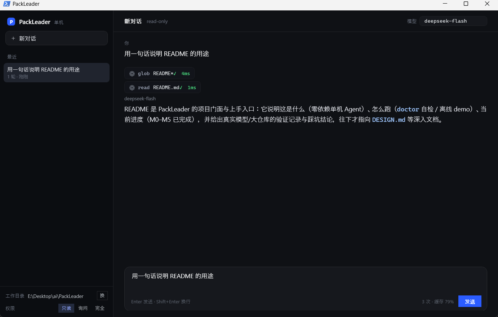

真 Windows 窗口（WPF），不是 Electron、也不是浏览器套壳：

| 部分 | 文件 | 体积 |
|---|---|---|
| 窗口（WPF / .NET Framework 4.8，系统自带） | `ui/PackLeader.ps1` | 34 KB |
| 引擎主机（NDJSON over stdio） | `src/host.ts` | 12 KB |

**装完不到 1 MB**（不含 Node 本体，见下）。没有 web 服务、没有端口、没有浏览器、没有 150 MB 的 Chromium。

界面照 DeepSeek Harness 的样式做：左侧会话栏、无气泡消息流、细描边卡片、等宽字体显示工具调用。
配色直接取自 DSH 自己的 CSS 变量（`#0f1115` 底 / `#f9fafb` 主文字 / 12% 白描边），
字号取自它的主题插件（正文 14px、代码小 1px、行高 1.6）。

窗口能做：左侧会话列表（点击切换、悬停出现 `×` 删除）、流式回答、Markdown 渲染（粗体 / 行内代码 / 标题 / 列表 / 代码块卡片）、
工具行（`⚙ read src/host.ts ✓ 1ms`）、审批卡片（允许一次 / 拒绝 / 看参数）、权限三档、
**模型设置（端点地址 + API Key + 模型名，存 config.json 且立刻生效）**、
换模型、换目录、新对话、停止、本会话用量与缓存命中率、空状态示例问题、↑↓ 翻输入历史。

**第一次启动**（没有任何 Key）会自动弹出设置面板——不用先去配环境变量才能看到窗口。

### 模型配置

界面上点右上角 `设置` 填三样：端点地址、API Key、模型名。保存后：

1. 立刻生效（不用重启，host 直接换掉 LLM 客户端）；
2. 写进 `<数据目录>/config.json`（默认 `~/.packleader/config.json`）：

```json
{
  "baseURL": "http://127.0.0.1:19790/v1",
  "apiKey": "sk-...",
  "model": "deepseek-flash",
  "vision": true
}
```

优先级：**命令行 > 环境变量 > config.json > 内置默认**。所以 CI 里照旧用 `PL_API_KEY` 覆盖，
桌面上用界面配置，两边不打架。界面上 Key 输入框永远留空、只显示 `sk-p…3456` 这种掩码，
回填明文这件事本身就不做。

**模型不用背**：点「拉取」，`GET {baseURL}/models` 拿回端点真实存在的模型列表，
点一个就填进输入框。拉不到会明说是哪个原因（没填 Key / HTTP 400 / 端点没返回列表），
不会静默失败。

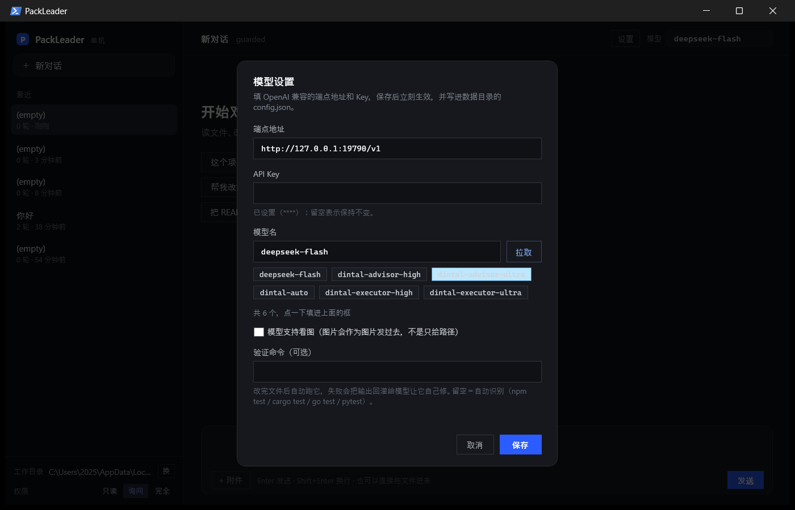

### 思考链和工具链路

host 一直在发 `reasoning` 增量事件，但界面以前没有对应分支，思考过程被直接丢掉了——
所以模型"想"了什么你完全看不见，只看到最后的答案。现在：

- **思考中**：流式展开显示，标题实时更新字数（`▾ 思考中… 316 字`）
- **出正文或开始调工具**：自动收起成一行摘要（`▸ 思考 · 316 字 · 6.4s`），点标题随时展开
- **工具调用**：一次调用一行，`⚙ read {"path":"package.json"}  ✓ 12ms`，失败变红 `✕`
- 历史会话同样能看：重放时把存过的 `reasoning` 画成收起状态，不是只有当场聊才有

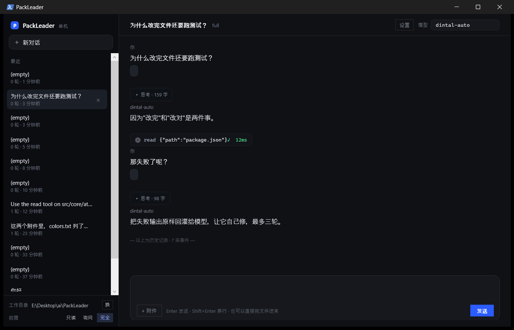

一句话：模型"想了什么、调了什么、成没成"三件事现在都在时间线上，而不是只在最后一句答案里。
### 附件和图片

输入区下面那条就是常用开关：左边 `+ 附件`、目录（点一下换工作目录），右边依次是**模型**（点开选）、**权限**（只读 / 询问 / 完全）、发送；`Ctrl+V` 粘贴截图或文件，也能直接把文件拖进窗口。图片附件在输入区就有缩略图，**点缩略图看大图**，点背景 / 右上角 × / 按 Esc 都能关。附件按"模型用不用得上"分三档：

| 类型 | 怎么进上下文 | 为什么 |
|---|---|---|
| 文本（`.txt .md .ts .json …`，≤120 KB） | **内容直接内联**成 `<file>` 块 | 省掉一次 `read` 工具调用，模型第一句话就能答 |
| 图片（`.png .jpg .webp .gif`） | 勾了「模型支持看图」就作为 `image_url` 发过去 | 不勾也能发，但模型只能看到文件名和大小 |
| 其它（pdf/zip/大文件） | 只给路径和大小 | 不能把 200 MB 塞进 prompt |

所有附件都会先**拷进** `<数据目录>/files/<会话id>/`，因为桌面上的文件可能下一秒就被删或改，
而会话是几天后还会重新打开继续聊的。会话日志里只记路径和大小，不存二进制。

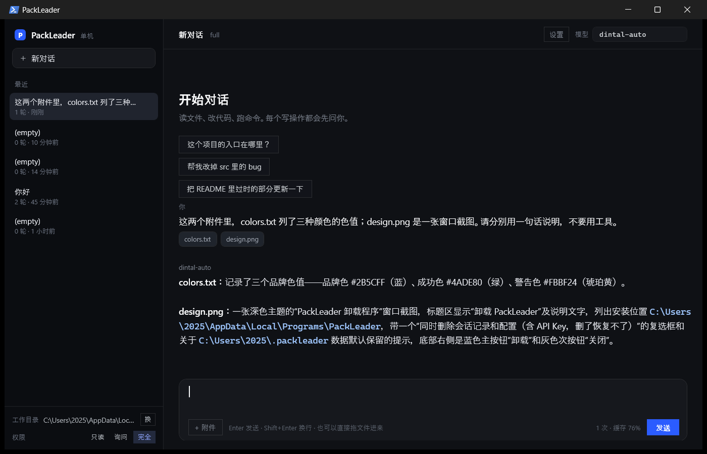

上面这轮是真的：模型读出了 `colors.txt` 里的三个色值，也**看见**了 `design.png` 那张截图
（它的回答里描述了离开窗的标题、勾选项和底部两个按钮）——图片确实走了多模态通道，不是只给个路径。

### 验证闭环

改完文件不算完，**跑过测试才算**。这一轮只要 `write`/`edit` 成功落盘，收尾前 agent 会自己跑一遍项目测试：

```
  ⚙ edit src/math.mjs
    ✓ 1ms
  🧪 验证 npm test
    ✗ 失败 exit 1 · 0.6s
    │ ✖ mul 应该是乘法
  ⚙ read test/math.test.mjs
  ⚙ edit src/math.mjs
  🧪 验证 npm test (第 2 次)
    ✓ 通过 0.6s
```

失败的输出会作为一条消息回灌给模型，让它自己对着红字修——不是把报告甩给你。

规则：

- **只在这一轮真的写了文件时才跑**，纯读的轮次不浪费时间
- 认项目：`package.json` 的 `scripts.test`（按 lockfile 选 npm / pnpm / yarn）、`Cargo.toml`、`go.mod`、`pytest.ini`；认不出就跳过并说明原因，绝不瞎跑一条错的命令
- 默认只重试 **1 轮**（`maxVerifyRounds` 可调），防止"永远红 → 无限修"烧钱；超时 180s，输出留头 2KB + 尾 6KB
- 关掉：`--no-verify`；指定命令：`--verify "node --test"`；界面上设置面板里也能填（留空＝自动识别）

上面的输出是真跑出来的：只让它修 `add`、并且明说"别动 mul"，它照做了；自动验证发现 `mul` 的测试也是红的，
把输出回灌后它去读了测试文件，把 `mul` 改成乘法——顺手也告诉了你"你让我别动，但不改测试永远红"。

### 删除会话

悬停会话行出现 `×` → 确认 → 删掉 `sessions/<id>/`、`ckpt/<id>/`、`files/<id>/` 三处
（少删一处会留悬空引用或孤儿附件）。如果删的正好是当前会话，host 会直接新建一个，
不会让你对着已删文件继续聊。

确认框是窗口内的深色浮层，不是系统 `MessageBox`——后者是白底系统字，在这套深色界面里
像从别的程序弹出来的（用户原话：「样式不统一」）。

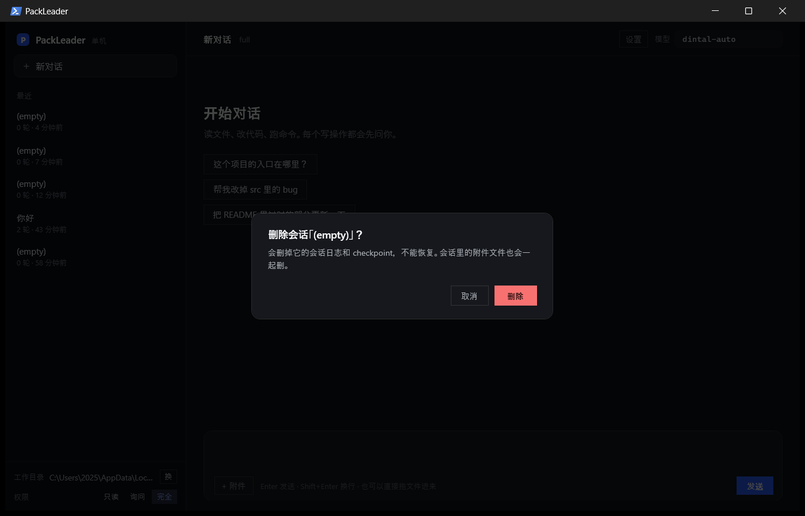

代码块渲染成带语言标签的卡片（`docs/code-block.png`）：

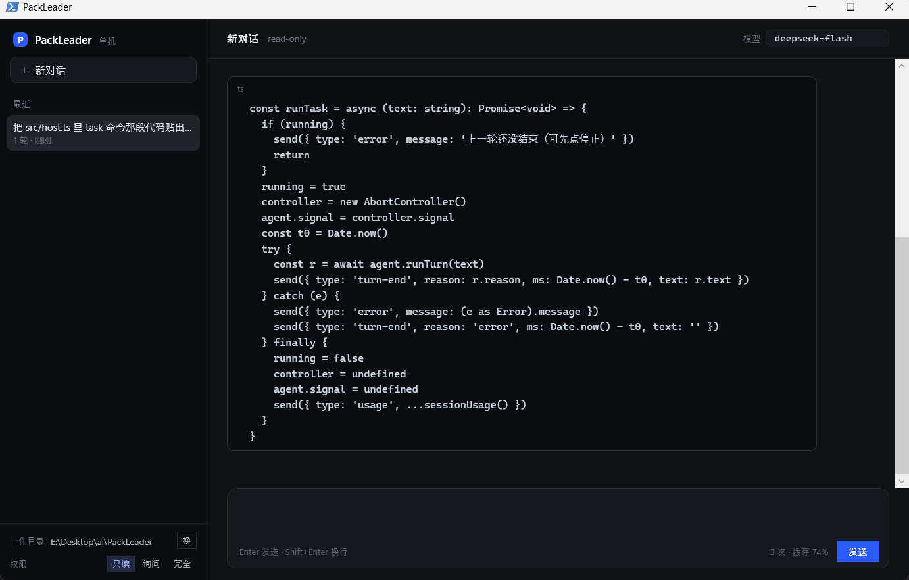

模型设置面板（第一次启动、或点右上角「设置」时出现）：

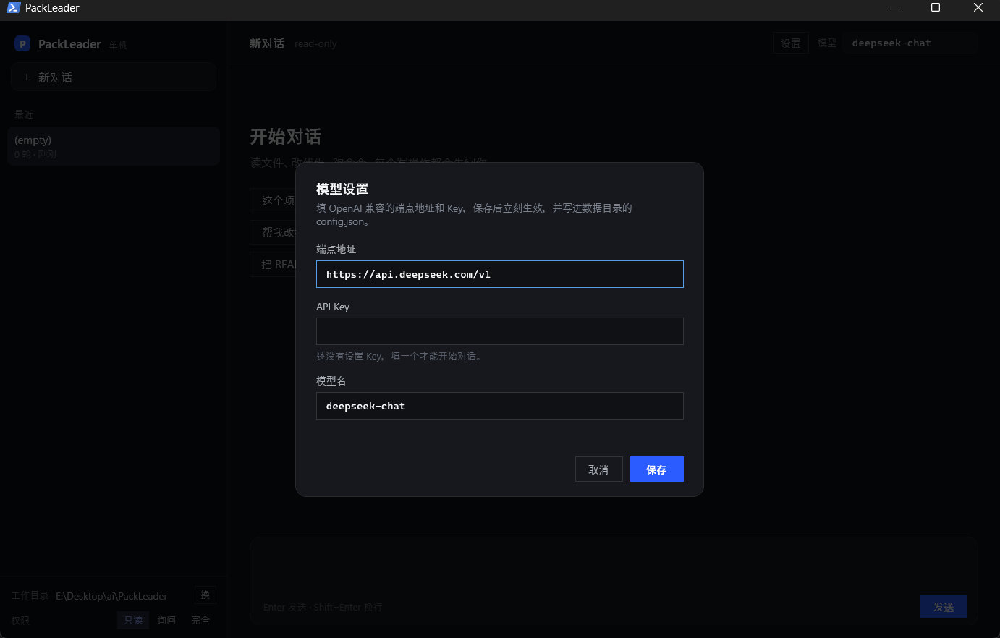

验证闭环在窗口里的样子（`🧪 验证 npm test ✓ 通过`）：

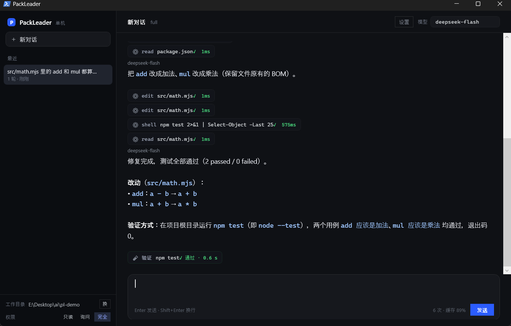

会话删除（悬停会话行出现 `×`）：

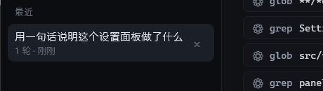

架构上一句话：**窗口只负责画，agent 只负责算**，中间是 JSON 行协议（`src/host.ts`），
所以以后把引擎换成 Rust、或者把窗口换成别的，两边都不用动。

依赖前提：机器上要有 **Node ≥ 22.18**。要"免装 Node 且仍然原生"，只能把引擎移植成 Rust/C#（见 [ROADMAP.md](ROADMAP.md) 的体积测算）。

已知没做：diff 预览、窗口无边框自绘标题栏、代码块横向滚动与复制按钮。

---

## 安装包（exe）

`npm run dist` 产出两个东西，都在 `dist/`：

| 产物 | 大小 | 说明 |
|---|---|---|
| `PackLeader-Setup-0.1.0.exe` | **270 KB** | 安装包：自解压 + 开始菜单/桌面快捷方式 + 注册卸载项，带安装界面，支持 `/S` 静默 |
| `PackLeader-0.1.0-portable.zip` | 70 KB | 便携版：解压即用，`PackLeader.exe` 双击开窗口 |

装完占 **484 KB**（23 个文件），不含 Node 运行时。

```powershell
npm run dist                                   # 构建
dist\PackLeader-Setup-0.1.0.exe                # 图形安装
dist\PackLeader-Setup-0.1.0.exe /S             # 静默安装
dist\PackLeader-Setup-0.1.0.exe --uninstall /S # 静默卸载（或开始菜单里的卸载项）
```

装到 `%LOCALAPPDATA%\Programs\PackLeader`，注册到「应用和功能」，
从开始菜单点开就是 `docs/installed.png` 里的窗口（深色标题栏，工作目录会记住上次用的）。

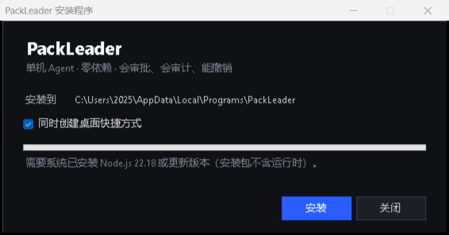

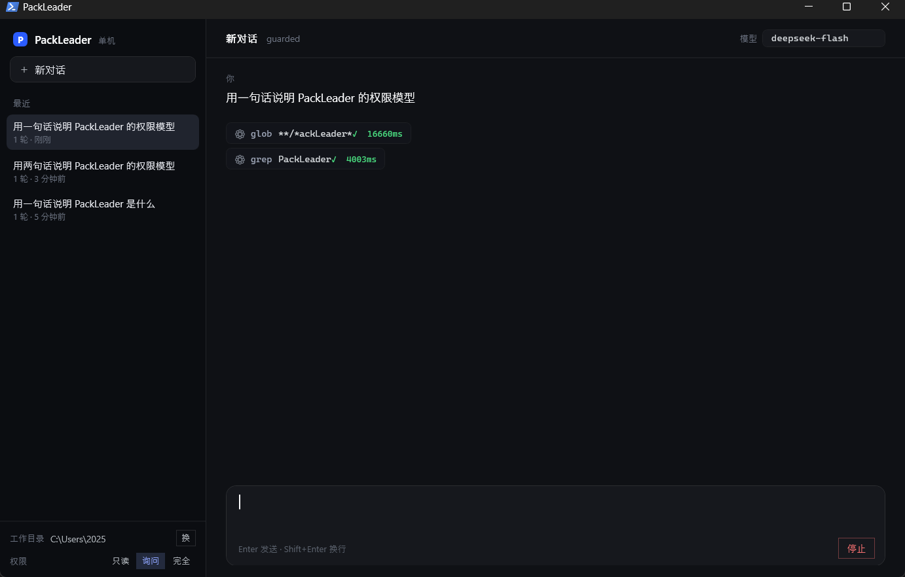

安装包会做的事：**先关掉正在运行的旧实例**（否则覆盖安装会 `IOException`）、
文件被占用时改名再写、写 `HKCU` 卸载项、建开始菜单/桌面快捷方式。

### 卸载

三条路都行：应用和功能里点「卸载」、开始菜单右键、或者直接双击安装目录里的 `Uninstall.exe`。

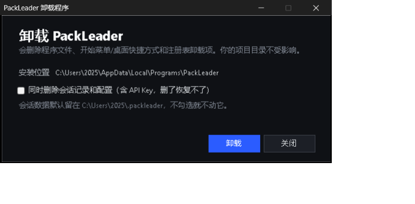

卸载会删掉程序文件、快捷方式和注册表项；**会话记录和 `config.json`（含 API Key）默认保留**，
勾上「同时删除会话记录和配置」才会一起清掉（`%USERPROFILE%\.packleader` + `%LOCALAPPDATA%\PackLeader`）。

这两个 bug 都是真机点出来的，单元测试碰不到：

- **双击 `Uninstall.exe` 弹出的是安装界面**。它其实是安装包的字节副本，只认 `--uninstall` 参数，
  没参数就落进 `SetupForm`。现在按"文件名 + 参数"双条件识别，卸载有了自己的界面（上面那张图）。
- **自删永远失败**。原来"睡 2 秒再 `del`"，但用户会盯着「已卸载」看一会儿，那时 exe 还占着；
  就算退出了，`cmd` 的工作目录又正好是安装目录，`rd` 删不掉自己的 cwd（实测留下空目录）。
  现在交给一个旁观进程 `Wait-Process -Id <pid>`，等本进程真退出了再删，工作目录设到 System32。

**启动链路**：`PackLeader.exe`（48 KB 原生启动器，C# 编译）→ 找到系统 Node → `node src/cli.ts gui` → WPF 窗口。
启动器不是壳：它会检查 Node 版本（低于 22.18 直接给中文提示而不是抛栈），抽取子进程输出防管道写满卡死，
并且在没有 `--cwd` 时用上次的工作目录。

**为什么安装包只有 270 KB**：不含运行时，复用系统的 Node。把这 30 MB 换来的只是"免装 Node"：

| 方案 | 安装包 | 前提 |
|---|---|---|
| 启动器 + 系统 Node（当前） | **270 KB** | 需 Node ≥ 22.18 |
| Node SEA 单文件 | 30–33 MB | 无 |
| Rust/Tauri 重写引擎 | 9–12 MB | 无 |

要走到第三行，得把引擎从 TypeScript 移植成 Rust——这是 [ROADMAP.md](ROADMAP.md) 里 P5 的事，不是打包能解决的。

构建脚本 `scripts/build-dist.ps1` 只用系统自带的东西：`csc.exe`（.NET Framework 4.8）编译启动器和安装包，
图标是脚本现画的（蓝色圆角方块 + 白色 P），负载用自定义容器嵌进安装包，所以不需要 NSIS / Inno / WiX。


### 命令行交互模式

行式界面（不是全屏 TUI）：横幅 → `›` 提示符 → 流式回答 → 工具行 `⚙ write hello.txt / ✓ 12ms`；
需要写权限时插入审批框，逐条问 `[y]/[n]/[d]`。

```
 PackLeader v0.1.0  ·  deepseek-flash  ·  guarded
 cwd: D:\work\proj
 session: s-mwuu35vh-3zj7

› 帮我创建 hello.txt
  ⚙ write hello.txt

┌ 需要确认 ──────────────────────────────
│ write  write 需要写权限
│ D:\work\proj\hello.txt
└────────────────────────────────────────
  [y] 允许一次   [n] 拒绝   [d] 看完整参数   (默认拒绝) y
    ✓ 1ms

已创建 hello.txt。
```

想自己看一遍：`node scripts/demo-repl.ts`（假模型，秒级，含审批 → `/undo` → `/sessions`）。

不复现全屏 TUI 是刻意的：`Renderer` 接口独立，以后想换 Ink 不用动 core。

环境变量：`PL_API_KEY` `PL_BASE_URL` `PL_MODEL` `PL_MODE` `PL_APPROVAL` `PL_SHELL` `PACKLEADER_HOME`

---

## 三档权限（默认 guarded）

| 模式 | 读 | 写文件 | 执行命令 | 越界写 |
|---|---|---|---|---|
| `read-only` | ✅ | ❌ 直接拒 | ❌ 直接拒 | ❌ |
| `guarded` **（默认）** | ✅ | 逐条询问 | 逐条询问 | ❌ 直接拒 |
| `full` | ✅ | ✅ | ✅ | ✅ |

- 审批是**一次性**的，没有「总是允许」——这是刻意的（见 DESIGN.md §6.3）。
- 没有可用审批通道时一律 **拒绝**（fail-closed）：`pl --deny` 用于 CI，非 TTY 环境下默认也是拒。
- `--yes` 只是跳过询问，**不能突破 `read-only`**，因为策略闸门在审批之前。
- 审计里 `--yes` 放行的记录会标 `auto`，与「人真的点过 y」区分开。

---

## 数据目录

默认 `~/.packleader`（`PACKLEADER_HOME` 可改）：

```
~/.packleader/
├─ sessions/<id>/session.jsonl    # 唯一真相：append-only 事件日志
├─ audit.sqlite                   # 投影：tool_calls / llm_calls / approvals / sessions
├─ ckpt/<session>/<turn>-<step>-<call>/   # 写前快照 + manifest
└─ spill/<ts>-<sha>.log           # 被截断的完整输出
```

三个特性因此成立：

- **能续跑**：`pl --resume <id>` / `--continue` 从日志重建对话，崩了最多丢最后一条
- **能重建审计**：`pl audit rebuild` 从 jsonl 重放，连工具参数和审批结论都能还原
- **能撤销**：写前快照 + 轮次级回滚，冲突时拒绝覆盖（`--force` 才强来）

---

## 已实现 / 未实现

**已实现（可跑、有测试、真模型验证过）**

- Agent 主循环：turn → step → tool batch，事件全落盘，`max-steps` 保护
- 19 个工具（原 7 个）
  - 文件：`read` `write` `edit` `glob` `grep` `list` `find` `outline` `stat` `hash` `move` `remove`
  - 运行时：`shell` `logtail` `processlist` `netprobe` `sysstat`
  - 便签：`todo_write`
  - 交互：`ask`（问用户一个选择题，界面画成选项卡）
- 三档策略 + 一次性审批 + fail-closed + `auto` 审计标记
- 写前快照与轮次级撤销（含外部改动冲突检测、超大文件跳过）
- 审计投影（SQLite，`node:sqlite`）+ 成本统计 + 从日志重建
- 工具结果截断 + 溢出落盘（head 60% / tail 25% + spill 路径）
- OpenAI 兼容流式适配器（`tool_calls` 按 index 分片聚合、`reasoning_content`、缓存命中统计）
- CLI：单次 / 交互 / doctor / audit / undo / sessions / `--json` NDJSON

**未实现（下一步）**

| 项 | 说明 |
|---|---|
| **上下文压缩** | 长任务里单次 prompt 会涨到 70k+；还没有摘要/裁剪策略，这是接更大仓库前该做的 |
| 全屏 TUI（Ink） | 当前是行式输出，`Renderer` 接口不变即可替换 |
| 会话选择器 | `--resume` 要手敲 id，交互模式还没有列表选择 |
| 内置 ripgrep | 现在是遍历 + 并行读（23k 文件约 1s），仍不如 `rg` 快 |
| 并行工具调用 | 模型一次给多个调用时仍是串行执行（DSH 那边有屏障/并行池，值得抄） |
| SEA 单文件分发 | 体积测算见 DESIGN.md §12（约 33 MB） |

---

## 代码地图

```
src/
├─ cli.ts                 命令行入口（解析 / 组装 / REPL / doctor）
├─ core/
│  ├─ events.ts           会话事件词汇（唯一真相）
│  ├─ session.ts          JSONL 日志 + deriveMessages 投影
│  ├─ loop.ts             主循环 + 工具流水线（策略→审批→快照→执行→截断→审计）
│  ├─ tools.ts            Tool 契约 + 注册表
│  ├─ policy.ts           路径边界 + 三档模式
│  ├─ approval.ts         一次性审批 broker（fail-closed）
│  ├─ checkpoint.ts       写前快照 + 撤销
│  └─ audit.ts            SQLite 投影 + 重建
├─ llm/openai.ts          OpenAI 兼容流式客户端
├─ tools/                 fs / runtime / shell / todo
└─ tui/                   ANSI 渲染 + 终端审批
```

**换 DSH**：`core/types.ts` 与 `core/tools.ts` 里的词汇（`LlmMessage` / `ToolSchema` / `Permission` / `Decision`）就是 DSH 的 seam 形状。要接 `dsh-agent-loop` 时，替换的是 `core/loop.ts` 与 `llm/openai.ts` 两个文件，其余（session、audit、checkpoint、tools）原样保留。

---

## 测试

```bash
npm test     # 或 node --disable-warning=ExperimentalWarning --test "test/*.test.ts"
```

133 个测试，覆盖：

- 会话恢复（含损坏半行、截断结果的说明文本）
- 文件工具与路径越界、`{a,b}` 大括号 glob、`path` 限定范围
- 资源文件默认跳过、大文件按字节预算分页
- 快照 / 撤销 / 外部改动冲突 / 一轮内多次编辑 / 超大文件跳过
- 审批三种结局（放行、拒绝、无通道 fail-closed）、`read-only` 下 `--yes` 仍拒
- 未知工具也进审计（`unknown-tool`）
- 真实两轮工具调用、`--continue` 历史重放所需的消息形状
- **到步数上限强制收尾**（断言收尾请求不带 tools）
- shell 解析 / 执行 / 退出码 / 超时杀进程
- 删库后从 jsonl 重建审计（参数、审批结论、auto 标记）
- 真实子进程的 CLI e2e（NDJSON 事件、退出码、sessions 列表）

---

## 安全边界（请读）

- 这是**防手滑**，不是防恶意。`workspace-write` 靠路径白名单 + 审批，不是容器隔离。
- 提示注入是真实风险：模型读到的文件内容可能诱导它执行命令。缓解手段是审批闸门，**不要把模式长期开在 `full`**。
- 审计库和生产文件都在本机，别把 `~/.packleader` 提交进仓库。
